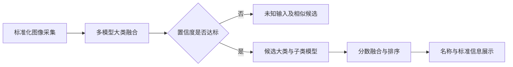

# 中药材智能识别系统

**算法研发与交付协作 · 2025年8月起的项目记录**

本项目面向标准化图像采集场景，结合多模型大类识别、未知输入拒识和细粒度子类分类，辅助识别中药材品种与形态。本目录整理我在既有团队框架上的算法实验、交付维护和数据治理工作。

公开内容包含项目复盘、架构说明、历史实验记录和[三端核心源码快照](source/README.md)。源码经过配置脱敏，保留原有研究和业务行为；模型权重、原始图像、数据库、Java用户服务与硬件运行环境未随仓库分发。完整运行条件见[复现说明](docs/reproducibility.md)。

## 项目亮点

| 方向 | 工作与结果 |
| --- | --- |
| 交付维护 | 补训子类模型、修复权重配置与标签映射问题，参与99大类/111小类版本的后端、硬件联调与交付收尾 |
| 泛化评估 | 在200类、5,974张已知类general测试图像上，MNv4指定检查点记录Top-1 95.88%、macro F1 0.9577 |
| 预处理对照 | 155类、4,737张general测试中，两组MNv4训练配置分别记录92.19%与96.20% |
| 错误溯源 | 区分已知误分、已知拒绝、未知误接受，辅助分析阈值取舍和困难类别 |
| 集成实验 | 推进200类五模型独立预处理、原图/翻转TTA、加权与3/4票策略，以及多GPU调度排查；源码状态与未完成项分别记录 |
| 数据与工程 | 参与采集、标签重构、测试集整理、训练可视化、现用权重归档和技术交接材料编写 |

指标对应具体数据、配置与检查点，不代表整个交付系统的统一准确率。general测试独立于训练过程验证，但历史实验多次使用它比较检查点，不能视为最终盲测。

## 技术栈与职责

- **训练与实验**：Python、PyTorch、timm、MobileViT、MobileNetV4、EfficientNetV2，以及其他架构对照；涉及Focal Loss、类别权重、数据增强和预处理一致性。
- **系统背景**：Vue/Electron客户端编排Flask/PyTorch识别服务与Java/RuoYi用户服务；相机和控制通过独立Python脚本及WebSocket连接，MySQL提供药材映射、标准信息和历史记录。
- **我的侧重**：算法训练与评估、子类识别、错误分析、数据与标签治理、模型部署配置排查及联调协作。

## 识别链路

交付后端快照配置的是五个99类主模型实例与子模型；200类属于后期训练和泛化研究范围。两者的组合、骨干和预处理存在版本差异，不将200类实验表述为已稳定上线的版本。

## 源码入口

| 模块 | 内容 | 阅读入口 |
| --- | --- | --- |
| 推理后端 | Flask路由、ModelManager、两阶段融合、药材与历史模型 | [后端说明](source/backend/README.public.md) · [模型管理器](source/backend/predict_two_steps.py) |
| 桌面前端 | Vue界面、图片与相机识别、Electron进程编排 | [前端说明](source/frontend/README.public.md) · [进程编排](source/frontend/src/main/backend-service.js) |
| 算法研究 | 训练、数据加载、网络、general、集成和错误分析 | [算法说明](source/algorithm/README.public.md) · [统一入口](source/algorithm/epoch_run.py) · [高级集成](source/algorithm/modelEnsemble/evaluate_advanced_ensemble.py) |

源码为脱敏研究快照，不是已完成端到端验收的独立发行包。当前明确的边界包括：高级集成的增强分支为空、不同评估路径预处理不完全一致，以及四卡性能尚未复测。见[源码核查记录](docs/source-review.md)。

## 代表性实验

| 任务 | 模型与配置 | 样本量 | 记录结果 |
| --- | --- | ---: | ---: |
| 155类已知类general | MNv4，Center Crop训练配置 | 4,737 | Accuracy 92.19% |
| 155类已知类general | MNv4，Force Resize训练配置 | 4,737 | Accuracy 96.20% |
| 200类已知类general | MNv4，epoch 42 | 5,974 | Accuracy 95.88% |
| 200类已知类general | 增强PAFPN，epoch 49 | 5,974 | Accuracy 92.60% |

前两项来自两组独立训练配置；后两项来自不同模型或策略。它们用于呈现实验观察，不构成某一个增强算子的单因素收益证明。

## 阅读导航

- [系统架构与推理逻辑](docs/architecture.md)
- [三端源码导航](source/README.md)
- [源码核查与实现完成度](docs/source-review.md)
- [个人贡献与工作时间线](docs/contributions.md)
- [实验结果与指标口径](docs/experiments.md)
- [23次200类评估摘要 CSV](results/evaluation-summary.csv)
- [复现条件与公开内容](docs/reproducibility.md)
- [历史资料索引](docs/evidence.md)

项目迭代从交付链路的具体修补，逐步推进到采集条件、预处理、类别体系、独立评估与集成效率的配套治理。
