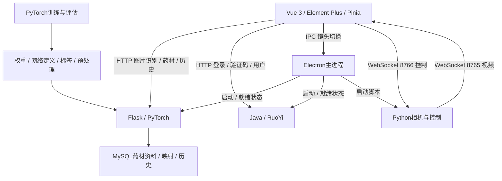

# 系统架构与推理逻辑

依据交接资料和三端源码整理。源码描述当前提供的历史工作树，不主张其等同当前线上版本。来源编号见[资料索引](evidence.md)，实现边界见[源码核查](source-review.md)。

## 运行组件



Electron主进程实际启动Flask可执行程序与RuoYi JAR；未在该前端工程发现Express业务服务器入口。Java与相机程序内部未包含在核心源码目录中，外部组件不能仅靠前端文件推定已验收。

当前主要上传和拍照组件均POST `/predict/batch`。Flask直接调用同进程 `ModelManager`，没有在HTTP请求与模型管理器之间经过旧TCP服务。后端仍保留 `model_server.py` 和 `predict_client.py`，其中导入与当前接口不匹配，归为历史残留路径。

源码定位：[Electron编排](../source/frontend/src/main/backend-service.js)、[当前上传](../source/frontend/src/renderer/components/ImgUpload.vue)、[Flask入口](../source/backend/app.py)、[预测控制器](../source/backend/controllers/predictController.py)。

## 主类融合与拒识

后端配置五个99类主模型实例、四种架构名称：

| 实例 | 输入处理 |
| --- | --- |
| MobileViT_large ① | 直接缩放640×640 |
| MobileViT_large_PAFPN | 短边640，再中心裁剪640×640 |
| MNv4_Conv_AA_Large | 同上中心裁剪 |
| EfficientNetV2_M | 同上中心裁剪 |
| MobileViT_large ② | 同上中心裁剪；使用另一检查点 |

对每张图，每个模型产生softmax向量 `p_m`，以自身最大概率作为权重：

```text
c_m = max(p_m)
q = sum(c_m * p_m) / sum(c_m)
accept = max(q) >= 0.51
```

权重随输入图像变化，不是固定的模型验证准确率。当前后端按模型依次前向，主类图像批次配置为8；“五模型集成”本身不代表模型级并发。

## Top5主类与子类排序

接受后，后端展开Top5主类候选：有子模型的类别取最多Top5子类，无需细分的类别直接形成候选，再全局排序。

```text
candidate_score = main_class_score * subclass_probability
```

最终返回首选和最多4个更多候选。`id` 是数据库全局子类主键；主网络索引、主类数据库ID、子网络内部索引和全局子类ID是不同层次的编号。

未知时 `id=-1`，更多候选是Top5主类的代表标准资料，未经过相应子模型。0.51只检查主融合最大概率，最终子类乘积分数不会再用同一阈值过滤；因此最终分数低于0.51与 `is_known=true` 可以同时出现。该分数用于系统决策与排序，没有据此认证药材真伪或质量的概率含义。

子类存在药材特定处理：拳参/栀子使用1280输入，麦冬等中心裁剪，陈皮先以传统轮廓质心提取patch；它不是可学习的语义分割模型。实现见[模型管理器](../source/backend/predict_two_steps.py)与[区域裁剪](../source/backend/segmentation.py)。

## 交付与研究版本

| 项目 | 99类推理后端 | 200类高级集成研究 |
| --- | --- | --- |
| 普通MobileViT_large | mobilevitv2_175 | mobilevitv2_200 |
| PAFPN骨干 | mobilevitv2_175 | mobilevitv2_175 |
| 模型组合 | 普通MobileViT两实例，另加PAFPN、MNv4、EfficientNetV2_M | 普通MobileViT、PAFPN、MNv4、EfficientNetV2_S、ConvNeXt_V2_Tiny |
| 输入 | 一项force_resize、其余center_crop | MNv4基础center_crop；其他四项force_resize+翻转TTA |
| 并行 | 逐模型前向 | advanced有线程池和模型级GPU分配，性能未复测 |

同名模型、相同类别数或相近文件名不足以确认权重兼容。200类有删除、合并、重编号，需要成套绑定网络、检查点、预处理、有序标签及数据库，不能只扩分类头或替换权重。

## 桌面与设备的完成度

当前界面已有图片/拍照识别、结果与候选、历史、药材库及PDF导出连接。配置页参数硬编码且禁用；数据采集主要是拍图与本地ZIP保存，未接通自动标注训练流程。硬件WS发送存在，不等于已经验证每条电气命令或设备动作。

启动就绪依据日志标记，后端标记先于HTTP监听；构建和外置程序布局仍有缺件。公开源码是研究快照，完整复现还需[配套资产与环境](reproducibility.md)。
